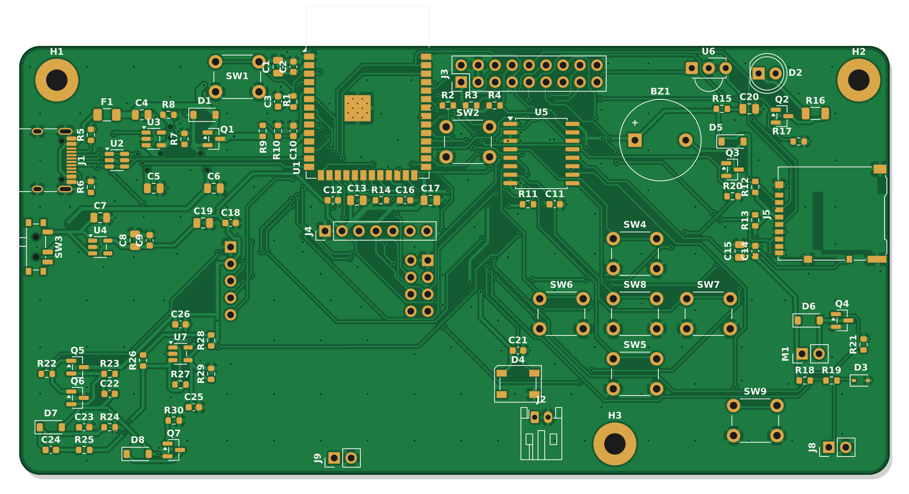

# DIY Flipper-style Multitool

A handheld, battery-powered hacking and learning multitool inspired by the Flipper Zero, built around an **ESP32-S3**. It brings together Sub-GHz radio, NFC, 125 kHz RFID, infrared, iButton, a microSD card, an OLED display with a D-pad, Wi-Fi and Bluetooth LE on one 130 x 64 mm board, and it will run its own custom firmware.



*Render generated from the KiCad files. The board has not been built yet.*

> **Note:** This is an independent hobby project. It is **not** affiliated with Flipper Devices and is **not** compatible with the official Flipper Zero firmware.

## Project status

| Part | Status | Details |
|---|---|---|
| Hardware (PCB rev 0.5) | Schematic and 2-layer PCB done, ERC and DRC clean. Not ordered or built yet. | [hardware/](hardware/README.md) |
| Firmware | Not started | [firmware/](firmware/README.md) |
| Enclosure | Not started | [enclosure/](enclosure/README.md) |

## What it does

| Function | Hardware |
|---|---|
| MCU, Wi-Fi, Bluetooth LE, USB | ESP32-S3-WROOM-1-N16R2, native USB-C for flashing, serial console and HID |
| Display and controls | 1.3" 128x64 OLED, D-pad (Up / Down / Left / Right / OK) and Back button |
| Sub-GHz radio | CC1101 module |
| NFC (13.56 MHz) | PN532 module |
| RFID (125 kHz) | Discrete reader front end *(experimental)* |
| Infrared | IR receiver and 940 nm IR LED |
| iButton | 1-Wire contacts |
| Storage | microSD card |
| Feedback | RGB LED, buzzer, vibration motor |
| Expansion | 2x9 GPIO header |
| Power | Li-Po battery with USB-C charging |

The full hardware description (schematic, PCB, parts list, assembly and pin map) is in [hardware/README.md](hardware/README.md).

## Repository structure

```
diy-flipper/
├── hardware/     KiCad project of the main PCB (schematic, PCB, symbol library, 3D model)
├── firmware/     custom ESP32-S3 firmware (not started yet)
├── enclosure/    3D-printable case (not started yet)
└── docs/         schematic PDF, bill of materials and the images used in the READMEs
```

Each folder has its own README:

- **[hardware/](hardware/README.md):** how the board works, the PCB, the parts to buy, assembly notes, the ESP32-S3 pin map and the checklist before ordering.
- **[firmware/](firmware/README.md):** target hardware for the firmware, which peripheral sits on which pin, and how to flash the board.
- **[enclosure/](enclosure/README.md):** board dimensions, parts that stick out of the board and the openings the case needs.
- **[docs/](docs/README.md):** what each document and image is and where it comes from.

## Getting started

- **Just looking:** open the [schematic PDF](docs/schematic.pdf) and the [bill of materials](docs/BOM.csv).
- **Editing the board:** install KiCad 10 or newer and open `hardware/diy_flipper.kicad_pro`. Keep the whole `hardware/` folder together.
- **Building one:** read the [hardware README](hardware/README.md), especially [Bill of materials](hardware/README.md#bill-of-materials), [Assembly notes](hardware/README.md#assembly-notes) and [Before ordering the PCB](hardware/README.md#before-ordering-the-pcb).

## Compared with a real Flipper Zero

- Each CC1101 module covers a single Sub-GHz band.
- PN532 card emulation is limited.
- The 125 kHz RFID front end is experimental and will need bench tuning.
- 5 V on the GPIO header is available only while USB is connected.
- No fuel gauge; the battery level is estimated from its voltage.

## Roadmap

- [x] Schematic
- [x] Component placement and 2-layer PCB routing
- [x] Bill of materials and module pinouts checked against the board
- [x] ERC and DRC in KiCad
- [ ] PCB order
- [ ] First prototype build and bring-up
- [ ] Custom firmware (display UI, input, SD card, IR, NFC, Sub-GHz, RFID, iButton)
- [ ] Enclosure

## Responsible use

This device is meant for learning and for working with your own hardware, cards and remotes. Transmitting on radio frequencies, and reading or copying access cards you do not own, may be restricted or illegal where you live. Check your local regulations and only use it on equipment you are authorized to test.

## License

*To be added* (for example CERN-OHL-S for the hardware and enclosure, and MIT or GPL for the firmware).
