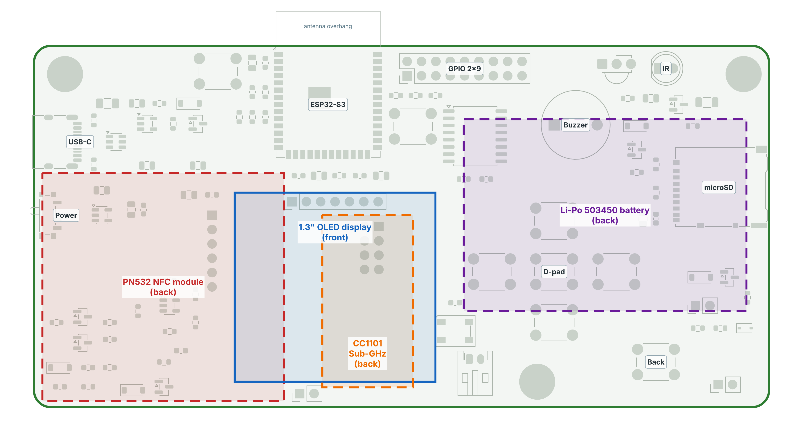

# Enclosure

3D-printable case for the [DIY Flipper-style Multitool](../README.md).

> **Status: not started.** This page lists the board data the case has to fit. Module outlines in the KiCad files are approximate, so measure the real modules before designing.

## Board

- **PCB:** 130 x 64 mm, 3 mm corner radius.
- **Mounting holes:** 3 x M3: H1 top left, H2 top right, H3 below the D-pad.
- **Exact outline:** export it from the KiCad project in [`hardware/`](../hardware/README.md), for example as a 3D model (PCB Editor → File → Export → STEP) or the board edge as a DXF (File → Plot → DXF, layer Edge.Cuts).

## Parts that stick out past the board edge

| Edge | Part | Notes |
|---|---|---|
| Top | ESP32-S3 antenna | Hangs about 6 mm over the edge. Keep only plastic around it, no metal. |
| Left | USB-C connector and power slide switch | Need openings in the side wall |
| Right | microSD slot | The card goes in from the right |
| Bottom | SMA connector of the CC1101 module | Sticks out about 4 mm; the antenna screws on here |

## Openings on the front

- **OLED window**, centre-left.
- **D-pad** (Up / Down / Left / Right / OK) to the right of the display, **Back** button lower right.
- **IR window** in the top-right corner, for the IR LED and receiver. The material has to let infrared through.
- **GPIO header** (2x9) on the top edge, right of the ESP32.
- **iButton contacts**, bottom right.
- **RGB LED and buzzer:** check their positions in the KiCad PCB; the LED needs a light pipe or a thin wall, the buzzer a sound hole.

## Back side (sets the case depth)

- **PN532 NFC module**, back left, about 42.7 x 40.4 mm, mounted on a spacer of a few millimetres (see the [assembly notes](../hardware/README.md#assembly-notes)).
- **CC1101 module**, behind the display.
- **Li-Po battery 503450** (about 5 x 34 x 50 mm), behind the D-pad.
- Keep metal away from the NFC antenna and the 125 kHz RFID coil, and keep the wall over them thin.

## Planned files

To be decided. Typically:

- the editable CAD source of the case;
- STL files ready to print;
- print settings (material, layer height, supports).
