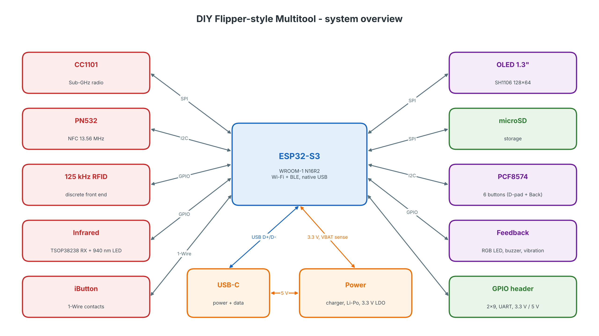
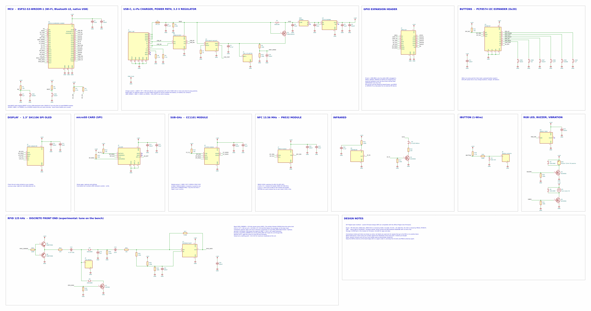
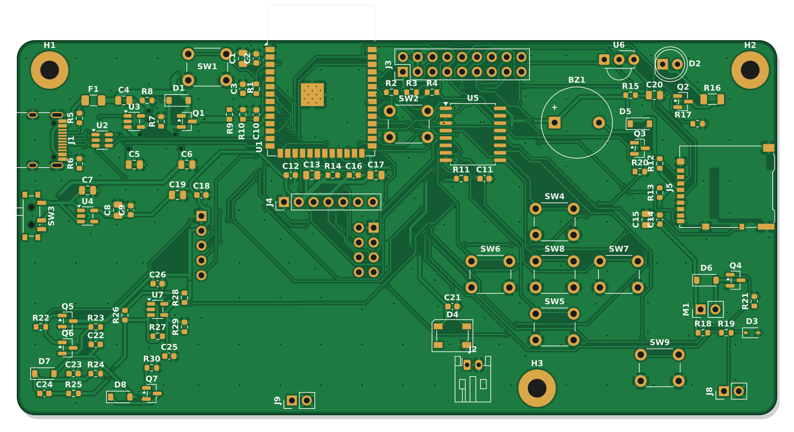
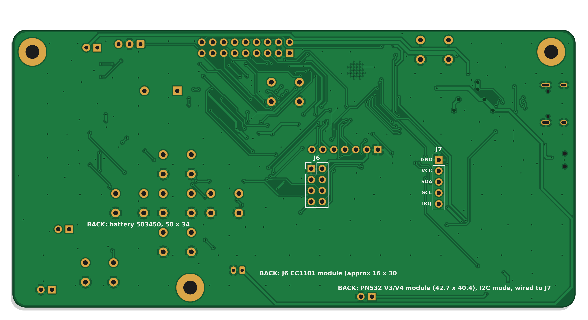
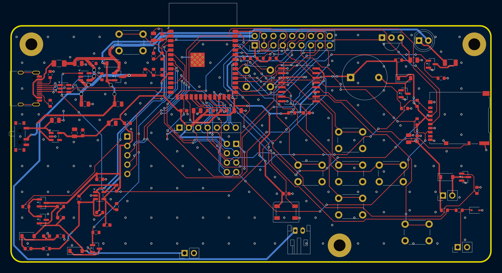
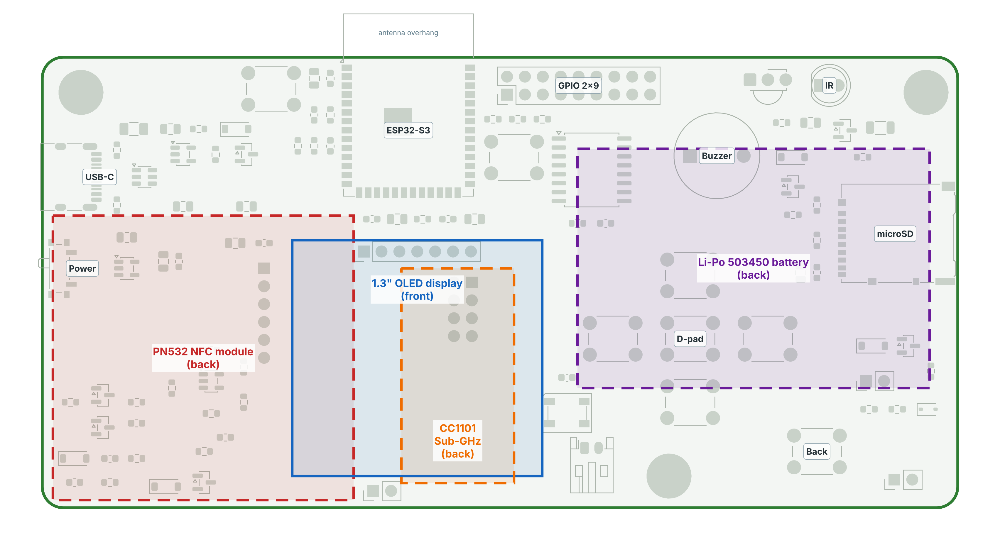
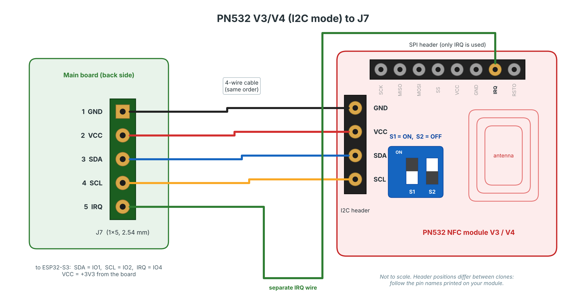

# Hardware

KiCad project of the main PCB of the [DIY Flipper-style Multitool](../README.md).

> **Status: rev 0.5**
> - Schematic and 2-layer PCB are finished. KiCad ERC and DRC report no errors (see [Before ordering the PCB](#before-ordering-the-pcb)).
> - Nothing has been ordered, built or tested yet. Always check pinouts against the datasheets of the parts you actually buy.

## Contents

- [Files in this folder](#files-in-this-folder)
- [Features](#features)
- [System overview](#system-overview)
- [Schematic](#schematic)
- [PCB](#pcb)
- [Bill of materials](#bill-of-materials)
- [Assembly notes](#assembly-notes)
- [Bring-up order](#bring-up-order)
- [ESP32-S3 pin map](#esp32-s3-pin-map)
- [Before ordering the PCB](#before-ordering-the-pcb)
- [Known risks](#known-risks)
- [Revision history](#revision-history)

## Files in this folder

| File | What it is |
|---|---|
| `diy_flipper.kicad_pro` | KiCad project. Open this one. |
| `diy_flipper.kicad_sch` | Schematic |
| `diy_flipper.kicad_pcb` | PCB layout |
| `DIYFlipper.kicad_sym` and `sym-lib-table` | The project's symbol library, with all the symbols used in the schematic |
| `3D_Models/` | 3D model of the OLED module, used by the KiCad 3D viewer |
| `place_diy_flipper.py` | KiCad scripting-console script that applies the v1 component placement. Only needed to redo the placement from scratch. |

The files are saved with **KiCad 10** and need KiCad 10 or newer. The symbol library and the 3D model are found relative to the project folder (`${KIPRJMOD}`), so keep everything in `hardware/` together. All footprints come from the standard KiCad libraries.

The schematic PDF, the bill of materials and the images below are in [`docs/`](../docs/README.md).

## Features

| Function | Hardware |
|---|---|
| MCU, Wi-Fi, Bluetooth LE | ESP32-S3-WROOM-1-N16R2 (16 MB flash, 2 MB PSRAM) |
| USB | USB-C, native USB for flashing, serial console and HID |
| Display | 1.3" SH1106 128x64 SPI OLED module |
| Sub-GHz radio | CC1101 module, EBYTE E07-M1101D (one band per module) |
| NFC (13.56 MHz) | PN532 V3/V4 module over I2C |
| RFID (125 kHz) | Discrete front end: driver, LC tank, diode detector, MCP6561 comparator *(experimental)* |
| Infrared | TSOP38238 receiver + 940 nm IR LED |
| iButton | 1-Wire contacts |
| Storage | microSD card (SPI) |
| Controls | D-pad (Up / Down / Left / Right / OK) + Back, via a PCF8574 I/O expander |
| Feedback | SK6812 RGB LED, buzzer, vibration motor |
| Expansion | 2x9 GPIO header (UART, free GPIOs, 3.3 V, 5 V) |
| Power | Li-Po battery, MCP73832 USB charger, power-path circuit, 3.3 V LDO, battery voltage monitoring |

## System overview



**Buses**
- **SPI** (SCK IO12, MOSI IO11, MISO IO13) is shared by the OLED, the microSD card and the CC1101.
- **I2C** (SDA IO1, SCL IO2) is shared by the PN532 and the PCF8574.

**Power chain**

```
USB-C -> MCP73832 charger (500 mA) -> power path (P-FET + Schottky) -> slide switch -> TLV75733 3.3 V LDO
                                   \-> Li-Po battery (VBAT/2 -> ADC for voltage readout)
```

## Schematic

[](../docs/schematic.pdf)

Each functional block has its own frame, and wires are drawn inside each block. Net labels are used only for signals that go to the MCU or to another block. Click the image for a zoomable PDF ([docs/schematic.pdf](../docs/schematic.pdf)).

## PCB

<table>
  <tr>
    <td></td>
    <td></td>
  </tr>
  <tr>
    <td align="center">Front side</td>
    <td align="center">Back side (seen from the back)</td>
  </tr>
</table>



*Routing: red = front copper, blue = back copper (ground pours hidden).*

| | |
|---|---|
| Board | 130 x 64 mm, 2 layers, 3 mm corner radius, 3 x M3 mounting holes |
| Tracks | 0.2-0.25 mm signals; 0.4-0.8 mm power; 0.4 mm IR LED and motor drive; 0.3 mm buzzer drive |
| Vias | 0.6 mm pad / 0.3 mm drill (tented) |
| Rules | 0.2 mm clearance, 0.5 mm to the board edge, 0.25 mm hole to hole |
| Ground | GND pours on both layers with thermal reliefs, plus stitching vias on a ~7 mm grid |
| Routing | 1212 track segments, 348 vias |

The rules fit a standard, low-cost 2-layer PCB service (0.2 mm / 8 mil track and gap, 0.3 mm drill). The exception is the 0.2 mm holes in the ESP32 thermal pad, which come from the KiCad library footprint: check them in the PCB maker's review.

### Module placement



- **One-sided assembly:** all SMD parts are on the front side, so the board can be soldered by hand or on a hot plate.
- **Front:**
  - The OLED sits centre-left, with the D-pad to its right.
  - The ESP32 is at the top edge, with its antenna hanging over the board edge (no copper under it).
  - The GPIO header and IR are at the top right.
  - USB-C and the power switch are on the left edge; the microSD slot is on the right edge.
- **Back:** the PN532, the CC1101 and the Li-Po battery (503450) mount on the back.
  - The CC1101 is behind the display. The battery is behind the D-pad: trim the button pins and insulate them with Kapton tape.
  - The PN532 is connected to J7 with short wires (see [Assembly notes](#assembly-notes)).

The renders are generated by a script from the KiCad files. They are not photos of a built board, and the module outlines are approximate.

## Bill of materials

About 104 parts, including the battery and the optional J7 header. The full list, with references, packages, suggested part numbers and notes, is in [docs/BOM.csv](../docs/BOM.csv).

These parts must be bought **exactly** as listed, because similar-looking variants have a different pinout or address:

| Ref. | Buy | Avoid / watch out |
|---|---|---|
| U1 | ESP32-S3-WROOM-1-**N16R2** | Not N16R8 / N8R8: on those, GPIO35-37 are used by the octal PSRAM |
| J4 | 1.3" SH1106 OLED, **SPI, 7 pins**, order GND VCC CLK MOSI RES DC CS (e.g. Pololu 3761) | Not the 4-pin I2C version; clones may use another pin order |
| J6 | **EBYTE E07-M1101D-SMA** (CC1101, 2x4 header) | Generic CC1101 boards use other pin orders; 3.6 V max |
| J7 | **PN532 NFC module V3 / V4** (Elechouse or the red V3 clone) | Set it to I2C mode: S1 = ON, S2 = OFF |
| U5 | **PCF8574T** (address 0x20) | Not PCF8574A (address 0x38) |
| U6 | **TSOP38238** (TSOP382xx / 384xx) | Other TSOP families swap VS and GND |
| U7 | **MCP6561T-E/OT** | Not MCP6561R / MCP6561U (different pinout) |
| U4 | **TLV75733PDBVR** (SOT-23-5, DBV) | Not the DYD / DRV packages |
| D4 | **SK6812 5050, 4 pins**, order 1 VDD, 2 DOUT, 3 VSS, 4 DIN | Other pin orders exist; rated from 3.5 V, runs at 3.3 V here |
| BT1 | Li-Po 503450 with protection, JST-PH 2.0, **pin 1 = +** (SparkFun / Adafruit polarity) | Many RC batteries are reversed: check with a multimeter |
| C22 | 4.7 nF **C0G / NP0** | Sets the 125 kHz resonance; X7R drifts too much |

## Assembly notes

### PN532 (NFC) on J7



- **J7** is a 1x5 header on the back. Its pins are 1 GND, 2 VCC (+3.3 V), 3 SDA, 4 SCL, 5 IRQ.
- Pins 1-4 are in the same order as the module's 4-pin I2C header, so a straight 4-wire cable works.
  - IRQ goes with a separate wire to the IRQ pin on the module's 8-pin header.
  - The module's reset pin is not used.
- Set the switches on the module to **S1 = ON, S2 = OFF** (I2C).
- The module is not soldered directly onto J7, because the position of its header is not published.
  - Fix it to the back with double-sided tape.
  - An NFC antenna works worse right on top of a ground plane. A few millimetres of spacer, or a ferrite sheet between the module and the board, helps the read range.

### Other modules

| Module | Board pins | Notes |
|---|---|---|
| OLED (J4, front) | 1 GND, 2 VCC, 3 CLK, 4 MOSI, 5 RES, 6 DC, 7 CS | Soldered straight into J4, no socket. Check the pin order printed on your module. |
| CC1101 E07 (J6, back) | 1 GND, 2 VCC, 3 GDO0, 4 CSN, 5 SCK, 6 MOSI, 7 MISO, 8 GDO2 | Seen from the back with the antenna pointing down: GND top left, VCC top right, GDO2 bottom right. The SMA connector sticks out about 4 mm past the bottom edge. J6's solder joints sit under the OLED, so trim them flush. |
| Battery (J2) | 1 = +, 2 = - | Check the polarity before plugging in. |

### Small parts

- **IR LED D2:** the cathode (short leg, flat side) goes in the square pad.
- **RFID coil J9:** about 345 uH. Together with C22 (4.7 nF) it resonates near 125 kHz. Tune it on the bench.
- **Buzzer BZ1:** passive type (no internal oscillator); the firmware generates the tone.
- **iButton J8, motor M1 and coil J9** use 2-pin header pads as placeholders: adapt them to the parts you use.

## Bring-up order

Build and test the first board in stages, so a fault is easy to find:

1. **Power stage:** USB-C, charger, power path and LDO. Check 3.3 V before fitting the ESP32.
2. **ESP32-S3:** check that it shows up over USB and can be flashed.
3. **Modules one at a time:** OLED and buttons first, then microSD, CC1101, PN532, IR, iButton and finally the 125 kHz RFID front end.

## ESP32-S3 pin map

| GPIO | Signal | GPIO | Signal |
|---|---|---|---|
| 0 | BOOT button | 15 | RFID carrier |
| 1 / 2 | I2C SDA / SCL | 16 / 17 | RFID modulation / data |
| 3 | Header (strapping pin) | 18 | *unused* |
| 4 | NFC IRQ | 19 / 20 | USB D- / D+ |
| 5 | Battery voltage (ADC) | 21 | Display reset |
| 6 / 7 | CC1101 GDO2 / GDO0 | 38 / 39 | IR TX / IR RX |
| 8 | CC1101 CS | 40 | iButton |
| 9 | microSD CS | 41 | I/O expander interrupt |
| 10 | Display CS | 42 | Buzzer |
| 11 / 12 / 13 | SPI MOSI / SCK / MISO | 43 / 44 | UART TX / RX (header) |
| 14 | Display D/C | 47 / 48 | Vibration motor / RGB LED |

GPIO 35-37 and 45-46 are routed to the header. GPIO 35-37 are only free on quad-PSRAM module variants, and 45/46 are strapping pins (keep GPIO45 low at boot).

**PCF8574 (I2C address 0x20):** P0 Up, P1 Down, P2 Left, P3 Right, P4 OK, P5 Back, P6 charge status, P7 SD card detect.

## Before ordering the PCB

1. **ERC:** done, no errors and no warnings.
2. **DRC:** done, no errors and no unconnected items.
    - The six "Silkscreen clipped by board edge" warnings come from the USB-C connector, the power switch and the ESP32 antenna outline. These parts hang over the edge on purpose, and the PCB maker simply trims the silkscreen there.
3. **Check the PCB maker's own review:** upload the Gerber and drill files and look at the automatic check and the price. Pay attention to the 0.2 mm holes under the ESP32.
4. **Check the fit:** print the board at 1:1 scale and lay the real modules on it, especially the OLED, the CC1101 and the battery.
5. **Check the footprints** against the parts you actually bought (for example the microSD card-detect pins).

> **Reference names:** on the PCB, the switches and two connectors are labelled by function (RESET, BOOT, POWER, UP, DOWN, LEFT, RIGHT, OK, BACK, microSD, "LiPo 3.7V JST-PH"), while the schematic still uses SW1-SW9, J5 and J2. Running **Update PCB from Schematic** would rename them back, so change the schematic references first if you need to run it.

## Known risks

- **125 kHz RFID:** the front end needs bench tuning and will have a short range at 3.3 V.
- **PN532:** reduced range over the ground plane (use a spacer or ferrite sheet); there is no reset line.
- **Module outlines** are approximate: print the board 1:1 and test-fit the real modules.
- **LDO:** drops out below about 3.5 V battery voltage, and runs warm on USB with Wi-Fi active.
- **SK6812** is rated from 3.5 V and runs at 3.3 V here.

## Revision history

| Rev. | Date | Changes |
|---|---|---|
| 0.3 | 2026-11-17 | First complete schematic; ERC clean, netlist imported into the PCB editor |
| 0.4 | 2026-11 | Same circuit, redrawn with wires inside each block |
| — | 2026-11-21 | Placement v1, 2-layer routing v1, BOM v1 and pinout check |
| 0.5 | 2026-11-22 | J7 changed to a 1x5 I2C header for the PN532 V3/V4; NFC reset line removed (GPIO18 free); ERC and DRC clean |
